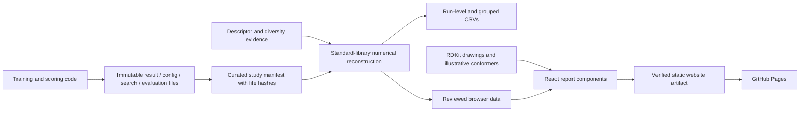

# Research project map

This repository contains the **ChemGPT reinforcement-learning study itself**: the training/scoring implementations, fixed protocols, completed experiment records, analysis code and derived presentation. The website is one downstream view of that project.

## Research questions

1. Does reward-driven policy learning improve independent terminal-policy samples?
2. Does that improvement translate into better candidate discovery under the same unique-query budget?
3. How much of the KL tradeoff can be explained by molecular size, trajectory length or proxy-reward structure?

## Code and experiment records

| Research component | Repository entry |
| :--- | :--- |
| Core REINFORCE / fixed-prior KL training and scorer | [`experiments/src/study.py`](experiments/src/study.py) |
| Model/token/probability runtime | [`experiments/src/model_runtime.py`](experiments/src/model_runtime.py) |
| Finite-MDP / score-function checks | [`experiments/src/check_theory.py`](experiments/src/check_theory.py) |
| Frozen core settings and budgets | [`experiments/contract.json`](experiments/contract.json) |
| Core and development results | [`experiments/collected_remote/results/`](experiments/collected_remote/results/) |
| KL dose / intervention / long-budget implementation | [`experiments/exploration_11h_20261114/src/`](experiments/exploration_11h_20261114/src/) |
| Frozen extension contract | [`experiments/exploration_11h_20261114/contract.json`](experiments/exploration_11h_20261114/contract.json) |
| Completed extension records | [`experiments/exploration_11h_20261114/collected/results/`](experiments/exploration_11h_20261114/collected/results/) |
| Exact replay, case and representation analyses | [`experiments/evidence/`](experiments/evidence/) and extension `evidence/` |
| Curated study population | [`data/study_manifest.json`](data/study_manifest.json) |
| Search/reward/property metrics | [`data/run_metrics.csv`](data/run_metrics.csv), [`data/summary_metrics.csv`](data/summary_metrics.csv) |
| Initial proposal and mathematical checks | [`proposal/`](proposal/) |

## Data lineage: from research to the webpage

`tools/prepare_report_data.py` verifies **506 source files**, reconstructs run-level values, complete-ledger search AUC, plotted discovery curves and terminal reward distributions, recomputes 30 summary groups, and checks the 252 selected case records against their original ledger rows. It preserves the source evidence and does not train or score new molecules.

The publication workflow rebuilds from those repository files rather than uploading an unrelated hand-maintained report. RDKit-dependent drawings and illustrative conformers are precomputed assets with preparation scripts and provenance; a normal deployment reuses them instead of performing chemistry or training on a web server.

## Current state and boundaries

- Completed analytical population: 18 core plus 108 extension runs, two tasks.
- Technical development runs and earlier route selection remain separate historical work.
- The model, tokenizer, software versions, configurations and hashes describe the actual experiments; downloaded weights and checkpoints are excluded from Git.
- Generation reward, search discovery, molecular properties and illustrative structure views are distinct evidence layers.
- Final course writing, member contribution confirmation and rehearsal are separate from completed computation.
- No biological activity, synthesis, binding-pose or clinical validation is claimed.

Start with the implementation and protocols above to inspect the project; use the website to explore its results. See [`REPRODUCING.md`](REPRODUCING.md) for the build and verification commands.
