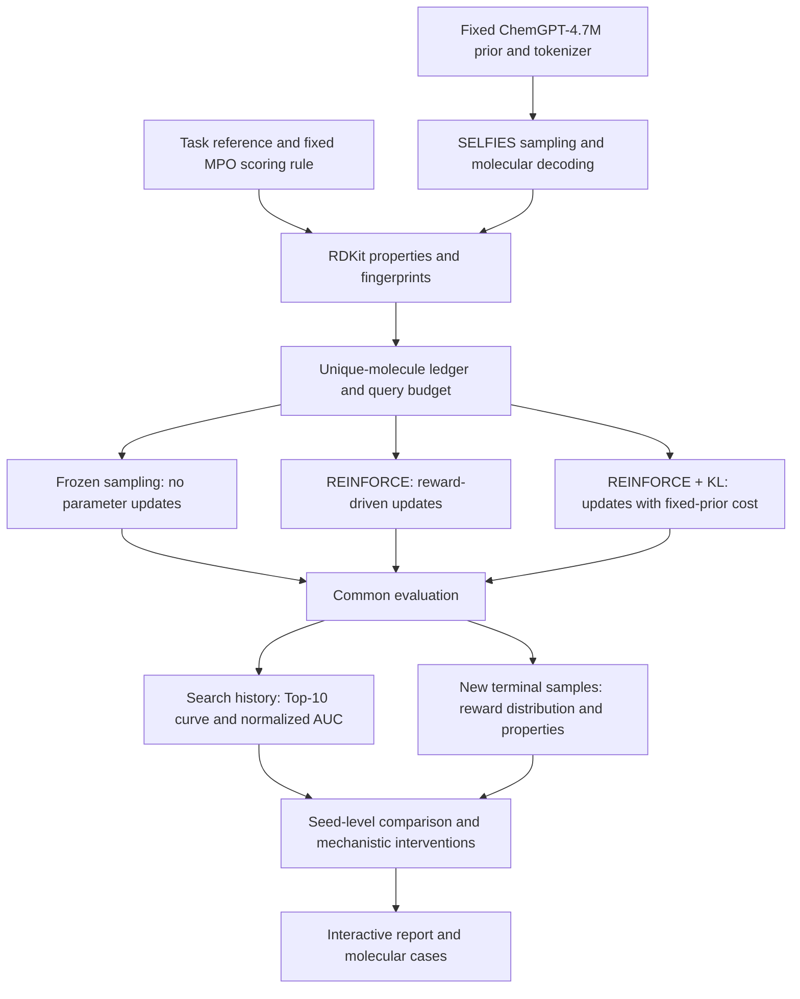

<h1 align="center">ChemGPT RL Study</h1>

<p align="center">
  <strong>Higher generation reward. Better molecular search?</strong><br>
  Training code, experimental records and reproducible analyses.<br>
  An interactive website built from the same research repository.
</p>

<p align="center">
  
  
  
  
</p>

<p align="center">
  <a href="PROJECT.md"><strong>Research project</strong></a> &nbsp;·&nbsp;
  <a href="experiments/src/study.py">Training code</a> &nbsp;·&nbsp;
  <a href="data/README.md">Experiment data</a> &nbsp;·&nbsp;
  <a href="https://zhichao-chang.github.io/chemgpt-rl-study/">Interactive report ↗</a> &nbsp;·&nbsp;
  <a href="#main-findings">Main findings</a> &nbsp;·&nbsp;
  <a href="#study-workflow">Study workflow</a> &nbsp;·&nbsp;
  <a href="#reproduce-the-presentation">Reproduce the presentation</a>
</p>

---

**强化学习提高了分子生成奖励，但搜索效率的收益小得多。** 本项目比较同一 ChemGPT 起点下的冻结采样、REINFORCE 和带固定先验 KL 成本的训练，并用长度成本、TPSA 干预和长预算实验检验性质漂移的解释。交互报告使用中文，连接研究问题、方法、总体分布、逐种子结果与具体分子。

This **ME2502 reinforcement-learning final project** separates two questions that are often conflated: what a trained policy usually generates, and what its search history discovers within a fixed number of unique molecular evaluations. All numerical comparisons come from completed experimental ledgers. Molecular scores and illustrative conformers are computational proxies, **not evidence of biological activity, synthesizability or clinical efficacy**.

## Start with the project

This repository contains the **research implementation and evidence**, with a website generated from them. The browser presentation is one output, alongside the original experiment records and analysis programs.

| What you want to inspect | Entry point |
| :--- | :--- |
| **Training and scoring implementation** | [REINFORCE / KL / MPO scorer](experiments/src/study.py), [model runtime](experiments/src/model_runtime.py) |
| **Research design and fixed protocols** | [Project map](PROJECT.md), [core protocol](experiments/contract.json), [extension protocol](experiments/exploration_11h_20261114/contract.json) |
| **Original experimental records** | [Core runs](experiments/collected_remote/results/main/), [extension runs](experiments/exploration_11h_20261114/collected/results/) |
| **Reusable numeric data** | [Curated population and data definitions](data/README.md), [per-run CSV](data/run_metrics.csv), [grouped CSV](data/summary_metrics.csv) |
| **Analysis and checks** | [Core analyses](experiments/evidence/), [extension analyses](experiments/exploration_11h_20261114/evidence/), [repository verifier](tools/verify_repository.py) |
| **Website source and data reconstruction** | [Report components](experiments/visual_report/src/content/report/), [data pipeline](tools/prepare_report_data.py), [build/deploy workflow](.github/workflows/report.yml) |
| **Read and reproduce** | [Interactive report](https://zhichao-chang.github.io/chemgpt-rl-study/), [reproduction guide](REPRODUCING.md) |

<table align="center">
  <thead><tr><th>Core comparisons</th><th>Extension runs</th><th>Selected case roles</th><th>Shared-subgraph comparisons</th></tr></thead>
  <tbody><tr><td align="center"><strong>18</strong></td><td align="center"><strong>108</strong></td><td align="center"><strong>252</strong></td><td align="center"><strong>306</strong></td></tr></tbody>
</table>

## Main findings

- **Generation improvement is much larger than search improvement.** Unregularized REINFORCE raises terminal mean MPO by approximately **2.4×** on Fexofenadine and **3.3×** on Osimertinib versus frozen sampling. The corresponding search AUC improvements are only approximately **0.5%** and **1.0%**.
- **KL changes the tradeoff, but it is not the only effective constraint.** In the five-seed Fexofenadine intervention cohort, KL and a length cost of 0.003 yield search AUCs of **0.6803** and **0.6802**. The length-cost condition has higher mean original reward. This is a limited-cohort observation, not an equivalence claim.
- **Property drift matters.** In that intervention cohort, mean TPSA is approximately **206 Ų** for RL, **135 Ų** with KL, and **118 Ų** with the exploratory TPSA cost. The raw scoring rule contains a TPSA lower target without a corresponding upper penalty.
- **Individual cases can contradict the aggregate direction.** Reward-typical examples are selected by reward, not by molecular weight or TPSA. The report retains these counterexamples rather than selecting only visually convenient molecules.

### Core comparison

Each row aggregates **three training seeds** under a budget of **3,000 unique molecular queries**. Terminal reward uses **1,024 new sampling attempts per run**, including invalid zero-reward outputs. Uncertainty below is the sample standard deviation **across training seeds**, not a confidence interval over generated molecules.

| Task | Method | Terminal mean MPO ± SD | Search Top-10 AUC ± SD |
| :--- | :--- | ---: | ---: |
| Fexofenadine | Frozen sampling | 0.2307 ± 0.0021 | 0.6748 ± 0.0027 |
| Fexofenadine | REINFORCE | 0.5515 ± 0.0094 | 0.6783 ± 0.0054 |
| Fexofenadine | REINFORCE + KL | 0.5103 ± 0.0033 | 0.6867 ± 0.0079 |
| Osimertinib | Frozen sampling | 0.1835 ± 0.0048 | 0.7487 ± 0.0075 |
| Osimertinib | REINFORCE | 0.6065 ± 0.0160 | 0.7561 ± 0.0077 |
| Osimertinib | REINFORCE + KL | 0.5925 ± 0.0030 | 0.7610 ± 0.0058 |

## Study workflow



- **Shared inputs:** the same pretrained model revision, tokenizer, molecular reward implementation and within-cohort query budget.
- **Optimization:** one on-policy update per fresh batch, leave-one-out baseline, FP32, fixed prior and explicit termination/probability masks.
- **Search:** budget counts new valid canonical molecules; duplicate reward evaluations do not create additional unique queries.
- **Evaluation:** historical best-found molecules and independent terminal-policy samples remain separate populations.
- **Interpretation:** compare original MPO, properties and diversity together. Modified training rewards are never substituted for original MPO in the reported comparisons.

### Experimental coverage

| Cohort | Tasks × conditions × seeds | Unique queries / run | Terminal attempts / run | Runs |
| :--- | :--- | ---: | ---: | ---: |
| Core comparison | 2 × 3 × 3 | 3,000 | 1,024 | 18 |
| KL dose scan | 2 × 6 × 5 | 3,000 | 512 | 60 |
| Mechanistic interventions | Fexofenadine × 6 × 5 | 3,000 | 512 | 30 |
| Long-budget validation | 2 × 3 × 3 | 10,000 | 1,024 | 18 |

The six technical development runs are preserved separately and are **not** counted in these 126 analytical runs. Budgets, regularization strengths and seed counts are study-design choices, not claimed course-mandated constants. Different cohorts are not pooled into a larger artificial replicate count.

## Explore the report

For the course presentation, try the [sampling-budget example](https://zhichao-chang.github.io/chemgpt-rl-study/#search-example), then follow [one molecular trajectory through a policy update](https://zhichao-chang.github.io/chemgpt-rl-study/#policy-update). The results and intervention sections show the search-AUC difference for each matched seed.

| Section | What it lets you inspect |
| :--- | :--- |
| **Research question** | Generation quality, query efficiency and reward-rule exploitation as distinct questions. |
| **Inputs and evaluation** | Reference molecules, fixed/variable conditions, sample counts and statistical units. |
| **Methods and flow** | Parallel sampling/training routes, the nested KL penalty, and actual inputs/outputs. |
| **Result comparisons** | Per-seed rewards, search AUC, terminal reward distributions and discovery curves. |
| **Difference analysis** | Within-run property quantiles, reward components, KL dose, length/TPSA interventions and long budgets. |
| **Molecular comparisons** | Free selection across methods, seeds and case roles, with shared-subgraph highlights and illustrative 3D overlays. |
| **Conclusions and decisions** | Supported findings, conflicting cases, limitations and the next discriminating comparison. |
| **Data and methods** | Exact seed-level values and CSV/SVG/PNG exports that retain the selected scope. |

**35 of 36 core molecular identities** have illustrative RDKit conformers; missing and extension conformers retain their 2D view. The 306 within-task core pairs have shared-subgraph comparisons, including 285 with available 3D alignments. A shared-subgraph fit is a geometric illustration, not a validated binding pose or a causal mutation analysis.

## View without training

The report is a self-contained static HTML file with its reviewed data, molecular drawings and viewer dependencies. No model weights, GPU, Python packages or author's running computer are needed by a deployed viewer. WebGL is needed only for the optional 3D window.

For a local copy of the complete research project:

```bash
git clone https://github.com/ZhiChao-Chang/chemgpt-rl-study.git
cd chemgpt-rl-study
python3 -m http.server 8000 --bind 127.0.0.1 --directory docs
```

Open **http://127.0.0.1:8000/**, or download `docs/index.html` and open it directly. The HTML is approximately **35 MB** because all reviewed data and molecular comparisons are embedded.

The report is deployed from this research repository to **https://zhichao-chang.github.io/chemgpt-rl-study/**. Each `main` push rebuilds numeric data from the selected research records, verifies it, and deploys the static report through GitHub Actions. The site is independent of the author's computer.

## Reproduce the presentation

The presentation's data, authored components and browser runtime are versioned together. Building it does not perform molecular generation or contact a GPU service.

Requirements: **Node.js 24**, npm and Python 3 standard library.

```bash
cd experiments/visual_report
npm ci
cd ../..
python3 tools/build_site.py
python3 tools/verify_repository.py
```

The builder first verifies 506 source files and reconstructs the numerical data, then verifies the included browser runtime, produces `docs/index.html`, and writes `docs/publication-manifest.json` with its SHA-256 and evidence cutoff. It does not require Codex, a locally installed plugin or an absolute path on the author's machine.

The **Research pipeline and Pages** workflow performs `raw records → numerical data → report build → independent checks → Pages deployment` on GitHub. Its artifact includes the originating commit and source-manifest identity. It neither retrains the model nor changes the recorded research results.

### Research reproducibility

The original experiment programs live under `experiments/src/`, with the extension implementations under `experiments/exploration_11h_20261114/src/`. Completed `result.json`, `config.json`, `search.jsonl` and `evaluation.jsonl` records are retained in their original directory structure. Run configurations and source hashes remain authoritative; historical bootstrap scripts are provenance, not instructions to launch a new cloud job.

The pretrained model is **`ncfrey/ChemGPT-4.7M`**, revision **`7438a282460b3038e17a27e25b85b1376e9a23e2`**. Model weights and training checkpoints are intentionally not stored in Git; download identities and hashes are recorded in `proposal/evidence/download_manifest.json`. The historical proposal-stage checks are documented in `proposal/REPRODUCING.md` and should not be confused with the later completed campaign.

## Repository layout

```text
README.md                             Research project entry point
PROJECT.md                            Code / protocol / data map
data/                                 Curated source manifest and derived numeric CSVs
REPRODUCING.md                        Build, verification and deployment notes
docs/                                 Portable static report and publication manifest
tools/                                Repository-local build and evidence checks
experiments/
  src/                                Core training and scorer implementation
  contract.json                       Frozen core experimental conditions
  collected_remote/results/           Completed core/development ledgers
  exploration_11h_20261114/            Extension protocol, implementation and ledgers
  evidence/                           Analyses, replay and representation checks
  visual_report/                      Editable report, reviewed snapshot and runtime
  visualization_work/                 Evidence preparation and visualization checks
proposal/                             Original proposal and supporting checks
selection/                            Historical route exploration; not current main results
REPORT.md                             Historical initial literature review, dated 2026-11-04
```

## Scope, evidence and rights

All 108 extension runs passed ledger checks and exact-token replay. The repository checker independently verifies the identities of 126 result files and recomputes the 30 summary groups. Numerical consistency is not evidence of chemical or biological validity.

The study does **not** establish universal KL superiority, clinical usefulness, synthesis feasibility, a new state of the art, or prospective out-of-task generalization. Final course writing, contribution confirmation and presentation rehearsal are separate deliverables from completed experiments.

Course slide downloads, environment caches, credentials, pretrained weights and checkpoints remain local. Third-party code and software retain their applicable rights; see [THIRD_PARTY_NOTICES.md](THIRD_PARTY_NOTICES.md). Public visibility does not relicense third-party assets or grant a blanket license over all repository content.
