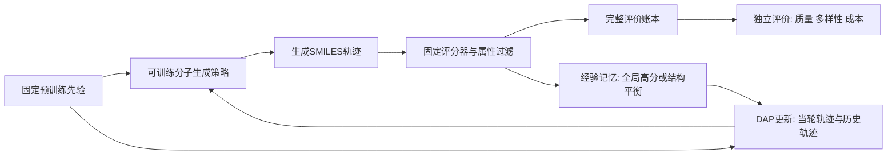

# RL课程选题：明确推荐、可行性证据与下一步

日期：2026-11-04。适用课程：ME2502 Reinforcement Learning。本文是本轮选题建议，尚未提交proposal；团队、成员分工和正式计算预算待定。用户已允许详细选题评估及简单尝试，本轮仅使用本地CPU，没有恢复旧暗蛋白研究，没有使用远程算力。

## 结论：我建议做什么

**首选题目：有限评价预算下的高质量、多样化分子生成——经验回放策略的受控研究。**

用一句话说明：**给模型同样多的分子评价机会，研究它该如何利用过去的好候选，才能获得更多不同、且达到质量要求的候选，而不只是把某一个分数推高。**

核心方法只改一件事：经验记忆保留与采样。比较不使用历史记忆、只保留全局高分候选、兼顾高分与结构系列覆盖的记忆。生成器、原始评价函数和主要训练规则保持一致。这里的“多样性记忆”是待检验的假设；本轮小试没有证明它更好。

这是针对课程完成度的推荐，不是断言它最可能发顶刊。老师不要求发表级创新，明确问题、正确实现、公平实验和深入解释更重要。相关路线已有充分研究基础，不能把scaffold分组、replay或多样性评价写成我们首创。

## 为什么在几个方向中选它

| 候选 | 能回答的清楚问题 | 适合本次作业之处 | 主要代价/风险 | 我的排序 |
|---|---|---|---|---|
| 有限预算下的经验利用与候选集合 | 记住哪些候选、怎样回放，能否改善质量—覆盖—成本关系？ | 公开先验已跑通，有现成任务和评价；改动局部，机制清楚 | 竞争成熟，不能许诺新算法或提升；计算量需核对 | **首选** |
| 多约束与稀疏奖励课程 | 连续反馈过渡到硬可行性，是否胜过始终连续或始终二元？ | RL课程概念直观，描述符评价便宜 | 硬阈值可能几乎无正例；自造稀疏任务需要说明现实含义 | **有力备选** |
| 固定数据DPO与新增在线反馈 | 现有偏好数据够不够，何时值得获取新评价？ | 课程明确接受DPO，问题与数据利用相关 | 数据覆盖、偏好构造和在线/离线预算变量较多 | 第三 |
| 口袋条件生成、3D与对接 | 条件信息是否降低新靶点优化所需反馈？ | 生物目标直接，后续可扩展 | 构象准备、对接设置、条件模型适配同时引入变量 | 本次不作首选 |
| 合成路线空间RL/GFlowNet | 生成质量与规则内合成可达性如何兼顾？ | 动作空间有化学意义，研究价值高 | 反应/原料环境和mask、路线oracle增加工程量 | 可单独成题，暂不并入 |

备选的独立评审见[evaluation_recommendation.md](evaluation_recommendation.md)，方法侧评审见[methods_recommendation.md](methods_recommendation.md)。两份评审的首选不同，本文根据已跑通的资源、变量控制和任务难度作出最终取舍，而非把所有路线拼起来。

## 科学背景和已有工作到哪里了

[REINVENT早期工作](https://doi.org/10.1186/s13321-017-0235-x)建立了预训练化学先验加反馈优化的经典路线。[PMO](https://arxiv.org/abs/2206.12411)强调在相同oracle预算下比较分子优化器，提醒最高分不能脱离成本解释。[Diverse Hits](https://doi.org/10.1021/acs.jcim.4c00519)进一步把高分且彼此不同的候选集合纳入评价，已有14类生成器比较。

[Augmented Memory](https://pubs.acs.org/doi/10.1021/jacsau.4c00066)与[Saturn正式版](https://doi.org/10.1038/s42256-026-01200-4)已研究经验复用、SMILES增强、记忆管理和样本效率。它们说明“反复利用高分经验”是重要现有路线，也意味着我们不能仅加一个buffer就声称提出新概念。[ACEGEN](https://arxiv.org/abs/2405.04657)提供不同算法/生成器的共用接口；本轮没有安装其完整环境。

**本课程可交付的贡献**是：在同一模型和静态任务反馈下，隔离经验选择的作用；用候选集合、最终策略及真实计算成本三种视角，验证什么时候高分回放值得用，什么时候保留结构覆盖有帮助。即使平衡记忆没有超过高分记忆，只要比较完整、解释有证据，项目仍成立。

不能把三个不同说法混在一起：“我们的实现已能训练”“某个具体策略在选定任务上更好”“提出了领域此前没有的方法”。本轮证据只支持第一个，并提供了小预算下的初步数值。

## 具体数据、模型和benchmark

### 已实际验收的资源

本地取得PMO官方公开checkpoint，仓库commit `2da631be85af8d10a2bb43f2de76a03171166190`：

- `Prior.ckpt`：16,697,208 bytes，SHA256 `6fa349413b1ab70134eaf4cc1900523119cf28806d7e63d6acfa001c60d6c3fc`。
- 三层GRU，hidden 512、embedding 128、55 token，共4,173,239参数。
- 权重以`weights_only=True`加载。将逐层GRUCell映射到融合GRU，输出最大差约`6.68e-6`；实际采样轨迹和teacher-forcing的log probability最大差约`1.53e-5`。
- 不需要从零预训练，不需要下载完整ChEMBL。预训练语料的完整来历/排重并没有在本轮重新验收；生成“新颖性”只能相对于明确可得的参考集解释。

### 本轮实际试验任务

使用[GuacaMol Fexofenadine MPO官方定义](https://github.com/BenevolentAI/guacamol/blob/60ebe1f6a396f16e08b834dce448e9343d259feb/guacamol/standard_benchmarks.py)：参考分子的atom-pair相似度、TPSA与Crippen logP的三项几何平均。它是可审计的计算多性质目标，**不是实测亲和力或疗效**。

本地评分与官方fingerprint/score modifier原语在7,568条有效分子记录上对照，最大数值差约`1.11e-16`。没有安装并完整运行GuacaMol benchmark harness，因此不能把本次分数当作官方排行榜复现结果。0.5/0.7/0.8的诊断阈值在比较前写入protocol；它们不意味着所有原始性质都合格。

### 建议正式任务：沿用Diverse Hits公开评分基础

正式选题更适合在不同目标预测任务下研究候选集合；Fexofenadine相似度任务用于开发和通路验证，不承担全部生物用途结论。

| 公开任务 | 官方`stats.json`报告的样本数 | 发布的`classifier.pkl`大小 | 本轮验收程度 |
|---|---:|---:|---|
| JNK3 | 50,390 | 10,608,812 bytes | 已核文件清单、统计与评分源码；未下载/加载分类器 |
| GSK3 | 52,802 | 26,964,492 bytes | 同上 |
| DRD2 | 102,981 | 24,480,332 bytes | 同上 |

这些数是上游的统计事实，不是本轮独立重建样本数。原始标签表、split和predictor已经发布；我们研究生成策略，不需要重新训练生物活性模型。分类器版本兼容和指纹一致性仍是正式实施前的必要验收，但不是从零造数据。

来源：[Diverse Hits官方仓库](https://github.com/ml-jku/diverse-hits)，以及其[评分实现](https://github.com/ml-jku/diverse-hits/blob/main/divopt/scoring.py)。模型预测的“hit”只代表公开预测器阈值命中，不能称实验活性；若没有独立评价器/实验，不能声称改善真实结合能力。

沿用任务的静态预测分数与固定属性过滤，关闭训练时依赖历史的动态多样性惩罚，便于只研究经验选择。独立评价参照其diverse-hit/#Circles思想。这是明确标名的**课程研究衍生协议**；如预算从原10K改为3K，也不能与论文表格直接比较SOTA。

## 技术路线：模块各负责什么

状态是当前SMILES前缀和剩余步数，动作为下一个token或EOS；完整候选得到终端反馈。原始采样轨迹用于likelihood，canonical分子身份用于去重和预算；二者不能替换。训练使用已有REINVENT类augmented-likelihood目标：

`L = mean[(log pi_prior(x) + sigma * R(x) - log pi_agent(x))^2]`。

这应准确称为DAP/augmented-likelihood优化。它不是PPO，也不能把历史replay直接宣称为无偏on-policy REINFORCE。可在报告里解释固定先验和reward时与policy-gradient正则目标的联系，以及历史经验改变训练分布的边界。

首版保持reward静态，只改变经验记忆：

1. 无历史replay，作为去掉记忆的消融。
2. 固定容量全局高分buffer，作为现有常见策略。
3. 同容量、同回放数、同采样规则的scaffold平衡buffer，作为待检验方法。

正式实验的无环结构回退、buffer容量、分组配额、warmup、tie规则在开发阶段固定。不能把所有空Murcko scaffold当成一个真实化学系列；本轮简易round-robin将空scaffold作同桶，且空桶数量很少，仅是预试实现，正式实现需修订并记录，不覆盖本轮原结果。

## 已经做了哪些简单尝试，结果是什么

先在固定seed下生成512个先验候选：475有效，475有效分子互不相同，436个非空scaffold；187个QED>=0.8。Fexofenadine MPO平均值为0.230（有效分子条件均值），没有>=0.7的候选。**QED单项已相当容易，多性质目标仍有学习空间。**

随后做4设置×3seed的小规模预试：每run达到512个独特有效候选后停止，训练组均17次更新，再固定重新采样128次评价最终policy。共12个run、其中9个真实训练，153次梯度更新；主预试8,226次评分入口调用，运行总墙钟约114秒（各run顺序累计），仅CPU两线程。

下表为3个seed均值，完整标准差和逐seed结果见[pilot_results/metrics.csv](pilot/pilot_results/metrics.csv)。最终均分把无效输出记0；“>=0.5”只是预先指定的计算分数阈值。

| 设置 | 发现的MPO>=0.5独特候选 | 其中非空scaffold数 | 最终输出平均MPO（无效=0） | 最终输出MPO>=0.5比例 |
|---|---:|---:|---:|---:|
| 冻结先验+等预算采样 | 79.0 ± 2.0 | 78.7 ± 2.5 | 0.213 ± 0.017 | 13.5 ± 2.7% |
| DAP，无历史replay | 116.3 ± 11.6 | 114.3 ± 10.7 | 0.303 ± 0.025 | 26.6 ± 6.2% |
| DAP+全局高分replay | 117.7 ± 10.2 | 116.0 ± 10.4 | 0.323 ± 0.003 | 32.0 ± 3.1% |
| DAP+结构平衡replay | 112.7 ± 13.2 | 112.0 ± 13.5 | 0.317 ± 0.010 | 32.3 ± 3.9% |

这组小试支持的结论：

- 公开先验、采样、评分、真实梯度更新和固定策略重采样已形成可运行流程。
- 在这一个开发任务的小预算下，反馈更新后最终输出的平均MPO和阈值通过率高于冻结先验，值得开展正式比较。
- **没有证明结构平衡replay优于高分replay。** 两者相近，且大多数命中本就属于不同scaffold，未观察到明显骨架坍缩；因此不能预设“原方法坍缩、我们修复”。
- 所有run都没有发现MPO>=0.8的候选；小幅综合分改善不能写成严格多条件设计成功，更不能写成药物有效。

重要计算边界：带replay每run参与训练的轨迹总数800，无replay为544。因此replay与无replay的差异**不能全归因于历史选样**，有额外训练数据/计算的混杂；两种replay的轨迹数和更新数匹配，但token长度未强制匹配。每run独特有效分子预算相同，实际生成/评分调用数不同，均逐run保留。本轮未实现重复候选的性质cache，不把重复计算冒充cache命中。正式实验将加入计算匹配的当前批次重用对照，或固定每次loss的总轨迹数，并另报真实token/时间。

## 正式课程实验如何比较

**核心四组：** 冻结同一先验+best-of-B、无历史replay的DAP、全局高分replay、结构平衡replay。条件允许时增加公开GraphGA，检验RL相对简单搜索的价值。所有初始种群/筛选产生的评分都计入预算。若最终主张“超过现有记忆管理方法”，还必须在同一prior、reward和预算下加入Augmented Memory的selective memory purge或对应公开实现；当前四组只能支持局部机制比较。课程可以明确只做受控研究，不需要在proposal承诺完整Saturn/Mamba重现。

第一阶段：固定一个开发任务，确定兼容性、budget与训练计算匹配，冻结配置。第二阶段：三任务×三seed，训练组27run，冻结基线9run；建议B=3,000新独特有效候选，固定额外policy评价样本数，并设总attempt/训练步/time上限。更高预算和5seed是扩展，不作为proposal的必要承诺。开发与确认seed分开；若所有任务都用于调参，必须如实写作开发后的benchmark比较，不称跨任务盲泛化。

主要看：固定质量门槛下的独特高质量候选数、采用独立指纹距离规则的diverse hits、它们随预算变化的曲线；同时报告top-10、最终policy固定样本的质量/有效率/重复率、真实成本。训练按Murcko组织记忆，评价用固定Morgan指纹距离，避免只用我们直接分组的计数证明自己好。

必须同时回答三件事：花预算找到过什么、最终策略通常会生成什么、为此实际付出了多少训练与评分成本。正式代码优先复用本轮已经验收的小型prior适配；无需把换框架、PPO、DPO、3D、合成路线都并入同一项目。

## Proposal怎么写，如何安排到课程截止

- 11月8日前：提交清楚的问题、文献基础、候选方法、任务与对照、资源和成员分工；不要把预试写成已完成正式benchmark。
- 第一周：任务评分器与identity/预算验收，确认开发配置，完成4组首任务。
- 第二周：完整核心矩阵，保留全部seed和失败run。
- 第三周：一个有针对性的消融，如buffer容量或回放比例；不要同时换backbone。
- 12月6日前：完成独立汇总、图表、报告与演示；按老师实际安排准备第13/14周展示，所有成员能解释自己的模块。

如果方法没有提升：报告它是在质量、覆盖或成本的哪个维度没有收益，说明充分回放/先验已多样等有证据的解释；不为了正结果不断换任务。若模型/评价器无法稳定运行，则退回已可运行的GuacaMol开发任务，清楚降低适用范围。备选“多性质稀疏奖励课程”可独立成题，不能中途无记录地混入主矩阵。

**本轮建议到此已足够具体，下一步可以据此讨论并写正式proposal；尚未启动上述正式多任务训练。**

复现入口与来源见[REPRODUCING.md](REPRODUCING.md)。
